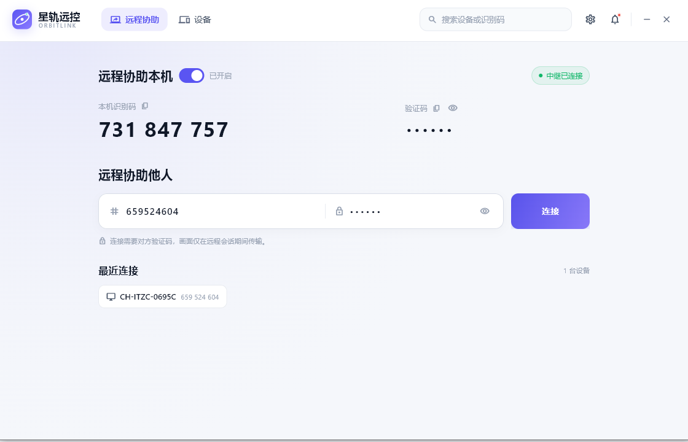
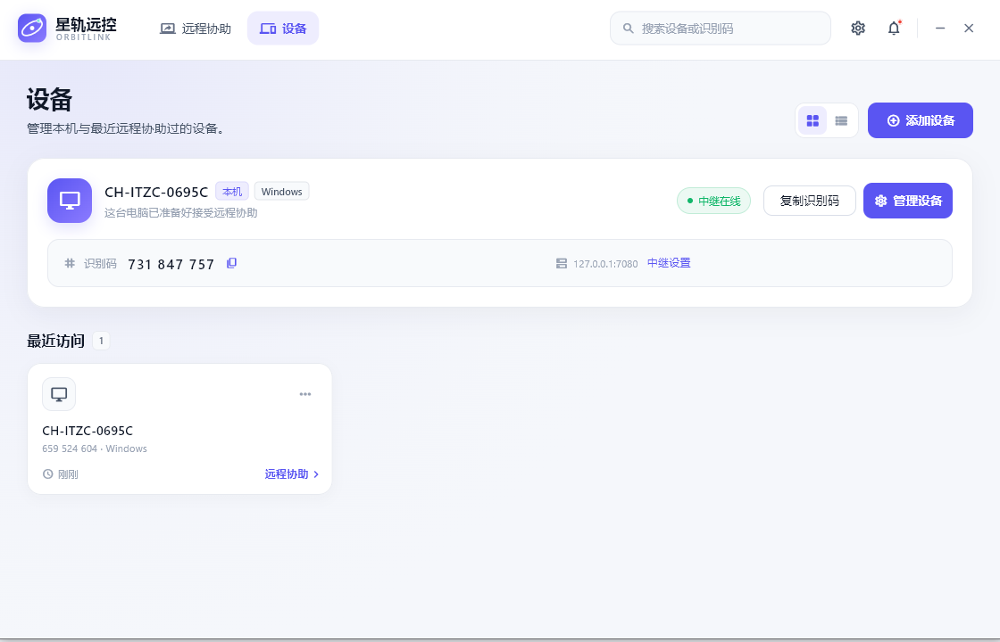
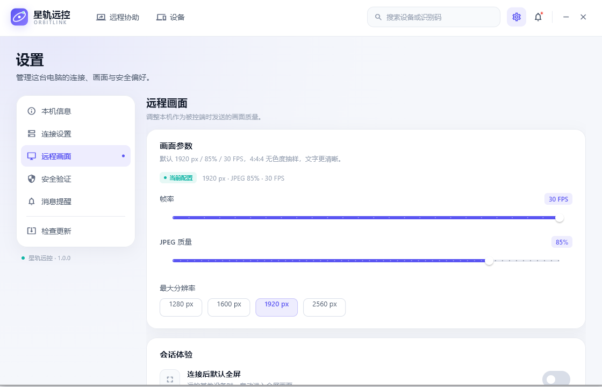
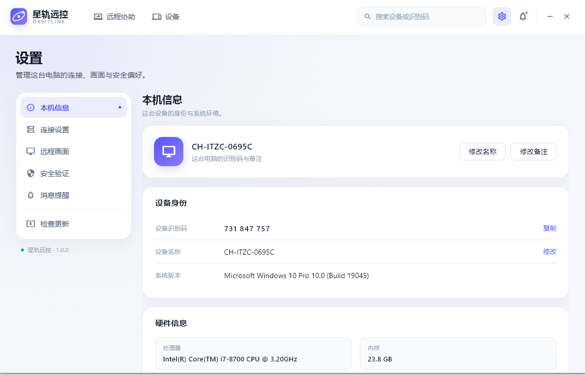
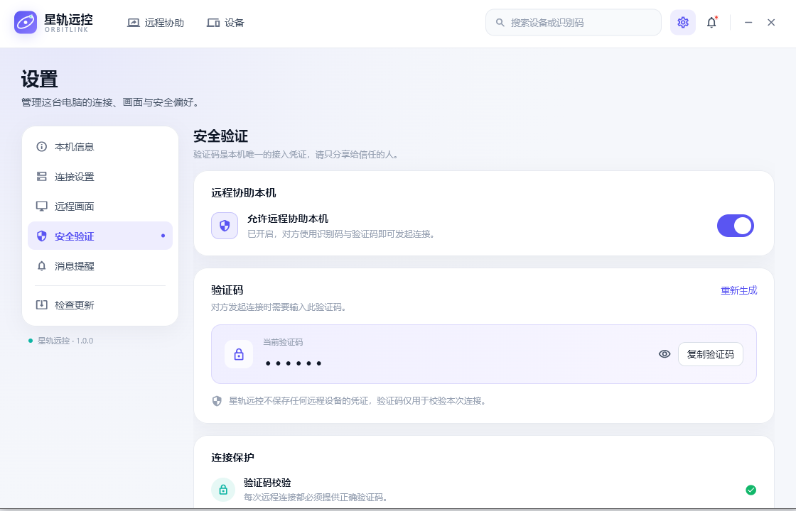
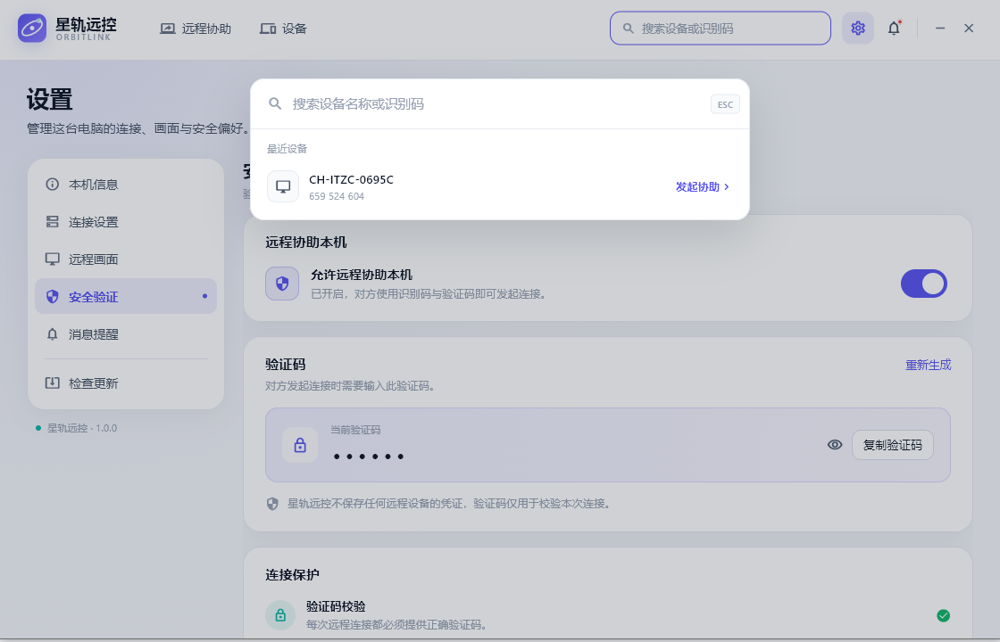
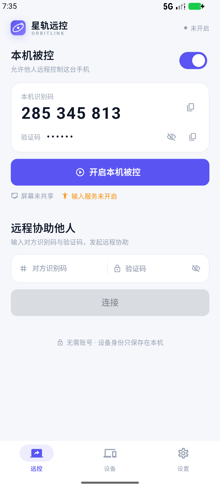
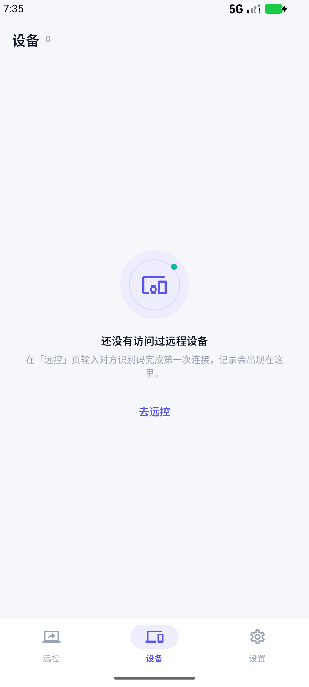
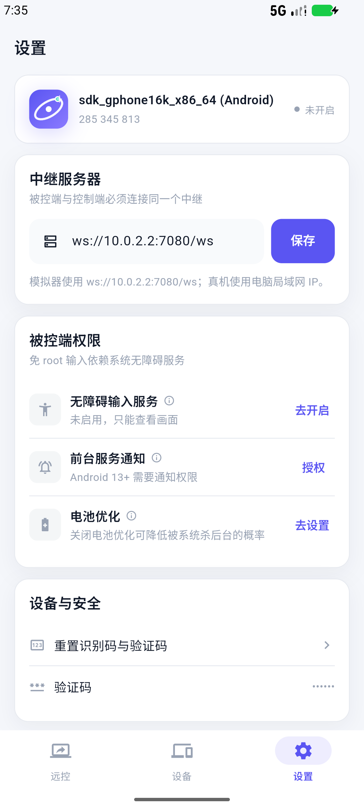

# 星轨远控 · OrbitLink

一套可运行的跨平台远程控制软件：Windows 客户端、Android 双角色客户端、Dart WebSocket 中继服务器。

**星轨远控**采用全新的浅色界面与「星轨」品牌视觉，使用 Material Icons 与自制品牌图形，不包含原版向日葵的图标字体、图片素材或品牌元素。启动即用，没有账号、登录、广告或推广位。

- **Windows**：Flutter UI → `dart:ffi` 调用 Win32 GDI / TurboJPEG / SendInput，真实屏幕采集与键鼠注入。
- **Android**：单个 APK 同时具备控制端与被控端，Kotlin `MediaProjection` + `AccessibilityService`。
- **中继**：Dart 编写的轻量 WebSocket 服务器，支持 Windows 可执行文件与 Docker 部署。

---

## 界面预览

<table>
<tr>
<td><br><sub>远程协助 · 本机被控与发起连接</sub></td>
<td><br><sub>设备 · 本机与最近访问</sub></td>
</tr>
<tr>
<td><br><sub>远程画面 · 帧率与画质</sub></td>
<td><br><sub>设置 · 本机信息</sub></td>
</tr>
<tr>
<td><br><sub>安全验证 · 验证码与连接保护</sub></td>
<td><br><sub>全局搜索 · 设备与识别码</sub></td>
</tr>
</table>

其余页面（连接设置、消息提醒、消息中心）见 [`docs/screenshots/`](docs/screenshots/)。

### Android

<table>
<tr>
<td align="center"><br><sub>本机被控 · 设备身份</sub></td>
<td align="center"><br><sub>设备 · 最近访问</sub></td>
<td align="center"><br><sub>设置 · 中继与权限</sub></td>
</tr>
</table>

---

## 功能

### 界面
- **1120×720 浅色无边框窗口**：顶部导航、靛紫 `#5A55F2` + 青绿 `#0FB5A5` 双色系统、原创星轨标志；最小 1000×640。
- **远程协助**：单列布局——顶部为本机识别码、验证码与允许协助开关；下方一行输入对方识别码和验证码并点击连接；最近一次连接信息会自动填入，最近设备以标签展示。
- **设备**：本机信息、最近设备网格/列表切换、添加设备、设备详情、删除记录。
- **设置**：本机信息 / 连接设置 / 远程画面 / 安全验证 / 消息提醒五个分区，只展示实际生效的设置项。
- **搜索与消息**：居中命令面板搜索本机与最近设备；右上角消息中心。
- **会话窗口**：深色沉浸画布、悬浮工具栏、FPS/RTT、画质切换、文本发送、剪贴板同步、截屏、全屏、结束确认。
- **无账号、无登录、无广告**；设备身份与访问记录只保存在本机。

### 远控内核（真实可用）
- 被控端注册到中继：9 位识别码 + 6 位验证码，心跳与自动重连。
- GDI 采集主屏（原生分辨率，32 位 DIB 直读）→ **libjpeg-turbo（TurboJPEG）4:4:4 JPEG 编码**，后台 Isolate，不阻塞 UI。
- WebSocket 二进制帧传输，支持流畅 / 高清 / 超清画质与 5–30 FPS（流畅 1280px/62%、高清 1920px/85%、超清 1920px/92%）。
- 控制端通过 `SendInput` / `SetCursorPos` 注入鼠标移动、按键、滚轮与键盘。
- 单向剪贴板同步、中文文本发送、截屏保存到 `图片\OrbitLink`。
- 被控端顶部会话提醒，可随时结束协助。
- 实测本机 1600×900 下约 **25–30 FPS**；局域网延迟通常在 1–20 ms，4:4:4 无色度抽样让文字更清晰。

### Android 双端
- **控制端**：输入识别码/验证码连接；连接 Android 自动使用触控模式，连接 Windows 使用鼠标模式；支持文本、系统键、画质、剪贴板与最近设备。
- **被控端**：前台服务 + `MediaProjection` 整屏采集 → JPEG → 中继；无障碍服务免 root 注入点击/滑动/长按/滚动/系统键/文本。
- **互通**：Android ↔ Android、Android ↔ Windows，共用同一中继与设备身份协议。

### 中继服务
- 注册、验证码校验、配对、双向转发、心跳、超时与断线清理。
- `GET /health` 健康检查，默认监听 `0.0.0.0:7080`，WebSocket 路径 `/ws`。
- Docker 多阶段构建、非 root、只读根文件系统、健康检查、SIGTERM 优雅退出。
- 客户端绕过系统 HTTP 代理直连，避免本地 WebSocket 被代理拦截。

---

## 快速开始（Windows）

### 1. 启动中继

双击 `start_relay.bat`，或：

```bat
server\build\orbitlink-relay.exe
```

首次运行如弹出 Windows 防火墙提示，局域网使用请允许**专用网络**。默认监听 `0.0.0.0:7080`。

### 2. 启动客户端

双击 `start_app.bat`。

- **被控端**：确保「允许协助」开启，把识别码和验证码告诉对方。
- **控制端**：在「远程协助他人」输入识别码与验证码，点击 **连接**。
- 两台电脑必须连接同一个中继：**设置 → 连接设置**，例如 `ws://192.168.1.10:7080/ws`。

Windows 客户端启动后会自动注册本机，不需要手动「开启被控」。

### 3. 本机双实例测试（可选）

双击 `start_second_instance.bat` 启动一个使用独立配置目录的第二实例：

- 两个实例拥有不同识别码，使用 `ORBITLINK_DATA_DIR` 隔离数据；
- 用实例 A 的识别码从实例 B 连接；
- 同机测试会出现光标回环与无限镜像，真实体验请用两台设备。

### 4. 无界面链路自检

在有被控端在线时：

```bat
dart tools\relay_smoke.dart --id 123456789 --password abcdef
```

脚本只收流、不注入输入，输出帧数、分辨率与配对结果。

---

## Android

```bat
cd mobile
flutter build apk --release
adb install -r build\app\outputs\flutter-apk\app-release.apk
```

当前包名：`com.orbitlink.remote`。

- 被控端每次开启都需要系统屏幕共享授权，并在弹窗中选择**共享整个屏幕**。
- 免 root 输入需要在系统设置中启用**星轨输入服务**（无障碍服务）。
- 模拟器访问电脑上的中继使用 `ws://10.0.2.2:7080/ws`；真机使用电脑局域网 IP。
- 完整构建环境、权限说明与已知限制见 **[mobile/README.md](mobile/README.md)**。

---

## 架构与协议

```
┌──────────────────────── 控制端 Flutter ────────────────────────┐
│  AssistPage ──► AppController ──► ControllerSession ──► WebSocket │
│                                        │                 │ JSON  │
│                                        ▼                 │ 控制  │
│                              ui.Image / RawImage ◄───────┘ 帧    │
└───────────────────────────────────┬─────────────────────────────┘
                                    │ ws://relay:7080/ws
┌───────────────────────────────────▼─────────────────────────────┐
│                     Dart 中继 · OrbitLink Relay                  │
│              注册 / 验证码校验 / 配对 / 双向消息与帧转发           │
└───────────────────────────────────┬─────────────────────────────┘
                                    │
┌───────────────────────────────────▼─────────────────────────────┐
│ 被控端 Flutter：HostEngine ──► CaptureWorker Isolate             │
│                     │              └─ GDI 采集 → TurboJPEG 4:4:4 JPEG │
│                     └─ InputInjector → SendInput / SetCursorPos   │
└─────────────────────────────────────────────────────────────────┘
```

信令为 JSON（`t` 字段区分）：`hello` / `hello_ok` / `connect` / `ringing` / `incoming` / `accept` / `reject` / `session_start` / `input` / `clipboard` / `control` / `stats` / `end` / `error` / `ping` / `pong`。

画面帧为 17 字节头 + JPEG：

| 偏移 | 长度 | 内容 |
|---|---|---|
| 0 | 1 | 帧类型 `0x01`（JPEG） |
| 1 | 4 | seq（uint32 LE） |
| 5 | 2 | width（uint16 LE） |
| 7 | 2 | height（uint16 LE） |
| 9 | 8 | 时间戳 ms（int64 LE） |
| 17 | n | JPEG 数据 |

服务端地址：`ws://<host>:7080/ws`，健康检查：`http://<host>:7080/health`。

---

## Docker 部署

中继是无状态的，不需要挂载卷。

```bash
docker compose up -d --build
docker compose ps
curl http://127.0.0.1:7080/health
```

镜像名：`orbitlink-relay:1.0.0`。容器以 UID 10001 的非 root 用户运行，根文件系统只读、丢弃全部 capabilities。

不使用 Compose：

```bash
docker build -t orbitlink-relay:1.0.0 ./server
docker run -d --name orbitlink-relay \
  -p 7080:7080 \
  --read-only --tmpfs /tmp \
  --cap-drop ALL --security-opt no-new-privileges:true \
  --restart unless-stopped \
  orbitlink-relay:1.0.0
```

| 环境变量 | 默认值 | 说明 |
|---|---|---|
| `PORT` | `7080` | 容器内监听端口 |
| `BIND` | `0.0.0.0` | 监听地址 |

公网部署请在 Caddy / Nginx 后使用 `wss://`，并在客户端中继地址中填写 `wss://relay.example.com/ws`。中继只负责配对与转发，不保存画面或设备数据。

---

## 构建

### 环境
- Flutter 3.24.5（stable）+ Dart 3.5.x
- Visual Studio 2022 / 2026，安装「使用 C++ 的桌面开发」与 Windows 10/11 SDK
- Android：JDK 21、Android SDK 34、build-tools 34、NDK 25.2.9519653、Gradle 8.13

### 命令

```bat
:: 中继
cd server
dart compile exe bin\server.dart -o build\orbitlink-relay.exe

:: Windows 客户端
cd ..\app
flutter pub get
flutter build windows --release

:: Android
cd ..\mobile
flutter pub get
flutter build apk --release
```

构建产物：
- 客户端：`app\build\windows\x64\runner\Release\orbitlink.exe`
- 中继：`server\build\orbitlink-relay.exe`
- APK：`mobile\build\app\outputs\flutter-apk\app-release.apk`
- Windows 发布包：`dist\OrbitLink-Windows-x64.zip`

> **VS 2026 兼容说明**：Flutter 3.24.5 默认只识别 VS 2019/2022。本机使用 VS Build Tools 2026（v18）时，已修改本机 Flutter SDK 的
> `packages/flutter_tools/lib/src/windows/visual_studio.dart`，增加 `18 => 'Visual Studio 18 2026'` 并重建 tool 快照。
> 该修改位于 Flutter SDK，不在本项目内；使用 VS 2019/2022 的环境不需要。

---

## 工程结构

```
OrbitLink/
├─ app/                              Flutter Windows 客户端
│  ├─ lib/
│  │  ├─ core/                       配置/身份/协议/AppController/WebSocket
│  │  ├─ engine/                     被控端引擎、控制端会话、采集 Worker、键位映射
│  │  ├─ native/                     Win32 / GDI / TurboJPEG / SendInput FFI
│  │  ├─ theme/                      星轨设计 token 与 Material 图标映射
│  │  └─ ui/                         顶部导航、页面、浮层、原创品牌组件
│  └─ windows/                       Windows runner 与 OrbitLink 图标
├─ mobile/                           Android 单 APK 双端（Flutter + Kotlin）
│  ├─ lib/                           控制端会话、移动 UI、桥接
│  ├─ android/.../orbitlink/remote/  HostService / MediaProjection / Accessibility
│  └─ README.md                      Android 构建、权限与验收说明
├─ server/
│  ├─ bin/server.dart                中继服务器源码
│  ├─ Dockerfile                     多阶段构建（Dart AOT + Debian slim）
│  └─ build/orbitlink-relay.exe      已编译的 Windows 服务器
├─ tools/relay_smoke.dart            无界面链路自检
├─ docs/screenshots/                 新版界面截图
├─ dist/                             Windows x64 发布包
├─ docker-compose.yml                Docker Compose 部署
├─ build_android.bat                 构建 Android Release APK
├─ install_android.bat               安装并启动 Android 客户端
├─ start_relay.bat                   启动中继
├─ start_app.bat                     启动客户端
└─ start_second_instance.bat         启动第二个本地实例
```

---

## 本机数据与安全

- Windows 数据目录：`%APPDATA%\OrbitLink\config.json`（设备身份、设置、最近设备、最近一次连接的目标与验证码）。
- 画面参数默认 1920 px / 85% / 30 FPS（4:4:4）；旧配置会自动升级到该档位。
- 最近一次连接信息会在下次打开客户端时自动填入，便于直接重连；删除该文件可移除保存内容。
- 可通过环境变量 `ORBITLINK_DATA_DIR` 指定其他目录。
- Android 数据：应用私有 `SharedPreferences`（`orbitlink_host`）与 `files/recents.json`。
- 没有云端账号或同步；删除数据目录即可重置本机身份。
- 所有连接都需要验证码校验；Windows 只在会话期间采集屏幕，Android 被控服务停止后立即释放采集。
- 中继使用 `ws://` 明文 WebSocket，公网部署必须加 TLS（`wss://`）与访问控制。

---

## 已知限制

1. **中继模式，不是 P2P**：所有流量经中继转发，跨公网请部署 TLS 反向代理。
2. **WebSocket 明文、验证码由中继校验**：仅建议用于可信环境；公网必须使用 WSS。
3. **JPEG 画面链路**：4:4:4 MJPEG 最高约 30 FPS，依赖 CPU 编码（libjpeg-turbo）；无 H.264/AV1、无音频、无多屏切换；独占全屏/硬件覆盖层可能采集为黑屏。
4. **部分会话工具仍是占位**：远程文件传输、文件闪传、语音聊天、隐私屏等尚未接入。
5. **Windows UIPI**：普通权限进程无法向管理员权限窗口注入输入，需要以相同权限运行。
6. **同机测试光标回环**：两端共享物理光标时会出现追尾与镜像，属于预期，请用两台设备体验。
7. **Windows 锁屏**：桌面处于锁屏/安全桌面时 GDI 采集会被系统阻止。
8. **Android 限制**：每次开启被控都要重新授权 MediaProjection；Android 14+ 复用单个 VirtualDisplay；分辨率在本次被控启动时固定；免 root 输入依赖无障碍服务，只能对焦点输入框注入文本；模拟器约 3–10 FPS。
9. **防火墙**：局域网互联需放行中继端口；Docker 部署需放行宿主机映射端口。

---

## 验证记录

- Windows：两台实例经本机中继完成会话，GDI 采集 26 FPS、RTT 1 ms；新界面逐页截图验收。
- Android：Release APK 在 Android 模拟器安装运行，被控端注册、整屏 JPEG 推流、系统键与触摸注入均已验证；新版界面截图见 `docs/screenshots/`。
- 中继：Windows AOT 可执行文件与 Docker 镜像 `orbitlink-relay:1.0.0` 均通过 `/health` 检查；容器只读、非 root 运行正常。

---

## 版权与依赖

- 本项目为独立实现。界面、星轨品牌标志、页面布局与文案为重新设计，使用 Material Icons 与自制图形，不包含向日葵图标字体、图片或商标素材。
- 逆向分析资料仅作为协议与实现思路参考，未作为界面素材分发。
- 第三方依赖：Flutter、window_manager、web_socket_channel、ffi、OkHttp。
- 画面编码使用 **libjpeg-turbo 3.1.0**（TurboJPEG API，IJG/BSD 许可），随 Windows 包附带 `turbojpeg.dll` 与 `third_party/libjpeg-turbo-LICENSE.md`。
